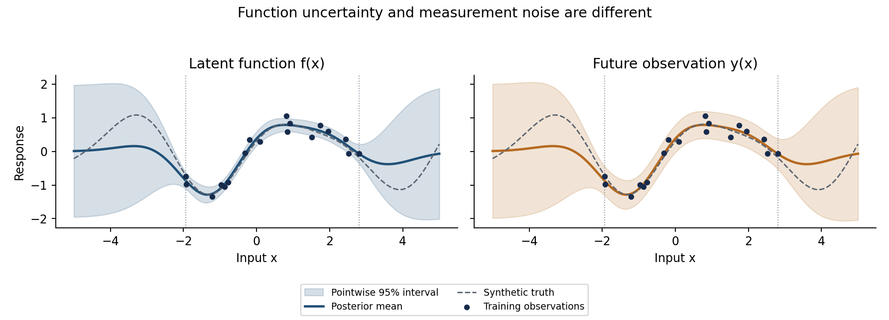

# Gaussian-process regression: prediction and uncertainty

**Sheima Alameeri, PhD**

A self-contained Python tutorial showing how Gaussian processes predict a smooth function and quantify uncertainty. All data are generated from scratch. This is an educational example separate from my dissertation code.



## What you will learn

- Build a GP posterior using an RBF kernel and Cholesky solves.
- Distinguish latent-function intervals from future-observation intervals.
- Explore length-scale choices and extrapolation.
- Evaluate predictive error, predictive density, interval coverage, and width.
- Verify the direct calculation against scikit-learn.

## Start here

Open **[gp_regression_tutorial.ipynb](gp_regression_tutorial.ipynb)** to read the explanation, code, and saved outputs. The notebook has already been executed from top to bottom; its figures and output do not require rerunning to view.

### Run locally

Use **Python 3.11 or newer**. From this project directory:

```bash
python -m venv .venv
# macOS/Linux:
source .venv/bin/activate
# Windows PowerShell instead:
# .venv\Scripts\Activate.ps1
python -m pip install -r requirements.txt
python run_tutorial.py
```

The last command executes the notebook's plain Python code cells in order, refreshes its saved outputs, and regenerates the figures and metrics under `assets/`. It does not require Jupyter. It only executes this project's trusted notebook.

For interactive use, install JupyterLab separately (`python -m pip install jupyterlab`), run `jupyter lab`, and open the notebook. Restart the kernel and run all cells after changing settings. No GPU, API key, or downloaded dataset is needed.

## Project contents

| File | Purpose |
| --- | --- |
| `gp_regression_tutorial.ipynb` | Tutorial with explanations and executed results |
| `run_tutorial.py` | Lightweight sequential notebook runner |
| `requirements.txt` | Pinned scientific dependencies |
| `assets/gp-uncertainty.png` | Function and future-observation intervals |
| `assets/length-scale-comparison.png` | Sensitivity to kernel length scale |
| `assets/synthetic-data.png` | Generated training observations |
| `assets/predictive-metrics.csv` | Metrics from the synthetic test example |

## Scope and interpretation

We use a zero-mean RBF GP with fixed hyperparameters and a known noise level. The intervals are pointwise Bayesian intervals conditional on those assumptions. Hyperparameter uncertainty is not included. A 95% interval does not guarantee 95% observed coverage for a fixed, potentially misspecified function. The small test example is descriptive, not a calibration benchmark or novel research result.

The tutorial includes checks against scikit-learn and verifies the relationship between latent and observation variance. The implementation uses Cholesky solves rather than an explicit matrix inverse. Exact GP training has cubic time and quadratic memory cost in the number of observations, so this example intentionally stays small.

The pinned scientific dependencies were used for the saved execution. JupyterLab is optional and was not needed for that execution.

## References

- Rasmussen, C. E., and Williams, C. K. I. (2006). *Gaussian Processes for Machine Learning*, Chapter 2. MIT Press. [Read the chapter](https://gaussianprocess.org/gpml/chapters/RW2.pdf).
- [scikit-learn Gaussian-process documentation](https://scikit-learn.org/stable/modules/gaussian_process.html).

## Contact

[sheima.alameeri@gmail.com](mailto:sheima.alameeri@gmail.com)
