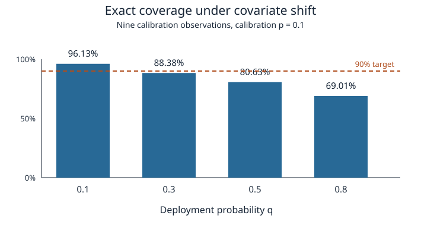

# Prediction intervals under distribution shift

Continue from the [adaptive-width conformal tutorial](../adaptive-conformal/README.md). That lesson adapted interval widths to changing error sizes within one population. This lesson changes the population that supplies future inputs and examines the resulting coverage.

You will work through a finite example, derive its coverage exactly, and reproduce the calculation by enumerating every possible calibration sample. The accompanying Python uses only the standard library.

## 1. Separate the calibration and deployment populations

Let $P$ describe the calibration population and $Q$ describe the deployment population. Under covariate shift, the input distribution changes while the conditional response distribution stays the same.

```math
P_X\ne Q_X,
\qquad
P(Y\mid X)=Q(Y\mid X).
```

Here $X$ denotes an input, $Y$ denotes its response, and the subscript $X$ identifies a marginal distribution over inputs.

Ordinary split conformal prediction uses exchangeability of the calibration pairs and the future pair, conditional on the data used to fit the predictor. Independent draws from one common distribution satisfy that assumption. Changing the distribution of the future pair can break it.

## 2. Use a deliberately simple response model

Take an input with two possible values, $0$ and $1$, and let the response equal the input.

```math
X\in\{0,1\},
\qquad Y=X,
\qquad \widehat f(x)=0.
```

The predictor is fixed in advance and always returns zero. It makes an error of zero in group $X=0$ and an error of one in group $X=1$. This deliberately poor predictor lets us see the entire calculation.

Choose nine independent calibration pairs from a population with

```math
p=P(X=1)=0.1.
```

A future pair is independent of the calibration sample and has

```math
q=Q(X_{\mathrm{new}}=1).
```

The quantities $p$ and $q$ are group probabilities. Keep $p=0.1$ and vary $q$. The rule $Y=X$ holds in both populations, so changing $q$ is a pure covariate shift.

## 3. Construct the ordinary split conformal interval

Use absolute residuals as calibration scores.

```math
R_i=|Y_i-\widehat f(X_i)|=X_i,
\qquad i=1,\ldots,m,
\qquad m=9.
```

For target coverage $1-\alpha=0.9$, calculate the corrected rank.

```math
k=\left\lceil(m+1)(1-\alpha)\right\rceil
=\left\lceil10(0.9)\right\rceil=9.
```

The ceiling rounds upward. Let $R_{(k)}$ denote the $k$th smallest calibration score. The threshold $T$ and prediction interval are

```math
T=R_{(9)}=\max(R_1,\ldots,R_9),
\qquad C(x)=[-T,T].
```

Every score is zero or one, so the possible calibration outcomes reduce to two cases.

| Calibration event | Threshold | Interval | Future response values covered |
| --- | --- | --- | --- |
| All nine inputs are zero | $T=0$ | $[0,0]$ | $0$ |
| At least one input is one | $T=1$ | $[-1,1]$ | $0$ and $1$ |

The interval can contain negative values even though this example's response support is $\{0,1\}$. Coverage is determined by whether the realized response belongs to the interval.

## 4. Derive coverage exactly

Let $A$ be the event that all nine calibration inputs are zero. Independence gives

```math
\Pr(A)=(1-p)^9.
```

An interval misses precisely when $A$ occurs and the future response equals one. The future pair is independent of the calibration sample, so

```math
\Pr\{Y_{\mathrm{new}}\notin C(X_{\mathrm{new}})\}
=q(1-p)^9.
```

Therefore the marginal coverage, averaged over calibration samples and one future pair, is

```math
c(p,q)=1-q(1-p)^9.
```

With the same calibration and deployment populations, substitute $p=q=0.1$.

```math
c(0.1,0.1)=1-0.1(0.9)^9=0.9612579511.
```

The coverage exceeds the 90% target. The scores have ties, and the usual split conformal interval may be conservative.

Now keep the calibration population fixed and increase the deployment probability to $q=0.8$.

```math
c(0.1,0.8)=1-0.8(0.9)^9=0.6900636088.
```

The coverage falls to about 69%. The conditional response rule and the predictor stayed fixed. The deployment population now places more weight on the group where the predictor makes errors.

## 5. Inspect the group coverage

The coverage in group zero is always one. Group one is covered exactly when at least one calibration input equals one.

```math
c_0=1,
\qquad
c_1=1-(1-p)^9.
```

The overall coverage is the deployment-weighted average of these group coverages.

```math
c(p,q)=(1-q)c_0+q c_1.
```

At $p=0.1$, group-one coverage is about 61.26%. Its low coverage is masked when that group represents only 10% of future inputs. As the deployment share increases, overall coverage moves closer to that group's coverage.

## 6. Exact results

| Calibration $p$ | Deployment $q$ | Marginal coverage |
| --- | --- | --- |
| 0.1 | 0.1 | 96.13% |
| 0.1 | 0.3 | 88.38% |
| 0.1 | 0.5 | 80.63% |
| 0.1 | 0.8 | 69.01% |



These values follow from the formula and finite enumeration. They average over all possible calibration samples, weighted by their probabilities.

## 7. Reproduce the calculation

Open [the notebook](distribution_shift.ipynb) to read the lesson beside the Python code, or run the companion script from the repository root using Python 3.11 or newer.

```bash
python distribution-shift/run_example.py
```

The script enumerates all $2^9=512$ binary calibration sequences and both possible future responses. It weights each outcome by its exact probability using Python's Fraction class. It compares the resulting coverage with the derived formula and checks that the outcome probabilities sum to one.

The numerical results and plot were independently verified using integer enumeration and the closed-form calculation. The Python script and notebook were reviewed but have not been executed in the authoring session. Notebook code cells retain empty outputs and an unset execution count.

## 8. Try two changes

1. Set $q=p$ while varying $p$. Compare the exact coverage with 0.90.
2. Keep $p=0.1$ and solve for the deployment probability at which coverage equals 0.90.

For the second exercise, rearrange the coverage formula.

```math
q=\frac{0.1}{(0.9)^9}\approx0.2581.
```

This crossing point is specific to this predictor, calibration size, and data-generating model.

## 9. Connect the result to calibration practice

This example shows how a change in group proportions can expose poor coverage in a particular group. Useful evaluations track coverage within relevant groups as well as overall coverage.

Adaptive-width scores can account for changing error sizes across inputs. Their ordinary split conformal guarantee still relies on exchangeability of the calibration and future scores. Score normalization by itself supplies no general correction for a changed deployment population.

Weighted conformal methods address covariate shift using the ratio of the deployment input distribution to the calibration input distribution, together with an appropriate weighted quantile construction. Their validity depends on the method's assumptions and treatment of those weights. The paper below develops that extension.

## Reference and attribution

Tibshirani, R. J., Barber, R. F., Candès, E. J., and Ramdas, A. (2019). *Conformal Prediction Under Covariate Shift*. Advances in Neural Information Processing Systems 32. [Read the published paper](https://proceedings.neurips.cc/paper/2019/hash/8fb21ee7a2207526da55a679f0332de2-Abstract.html).

The finite example, derivation, figure, and companion code were prepared for this educational series with AI assistance. They use synthetic data and a fixed predictor.
